<!-- Generated by scripts/build.py from profile.json. Edit those, not this file. -->
<a href="https://v0-senior-frontend-developer-portfo.vercel.app"><picture><source media="(prefers-color-scheme: dark) and (max-width: 600px)" srcset="assets/hero-phone-dark.svg"><source media="(max-width: 600px)" srcset="assets/hero-phone-light.svg"><source media="(prefers-color-scheme: dark)" srcset="assets/hero-dark.svg">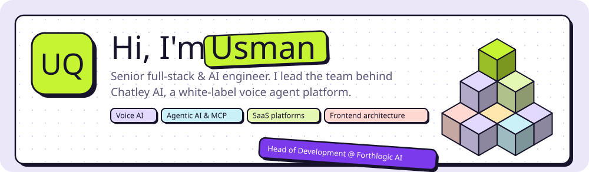</picture></a>

<a href="https://v0-senior-frontend-developer-portfo.vercel.app"><picture><source media="(prefers-color-scheme: dark)" srcset="assets/badge-site-dark.svg"></picture></a>
<a href="https://www.linkedin.com/in/qasimusman/"><picture><source media="(prefers-color-scheme: dark)" srcset="assets/badge-li-dark.svg"></picture></a>
<a href="mailto:1998usman@gmail.com"><picture><source media="(prefers-color-scheme: dark)" srcset="assets/badge-mail-dark.svg"></picture></a>
<a href="assets/Usman_Resume.pdf"><picture><source media="(prefers-color-scheme: dark)" srcset="assets/badge-cv-dark.svg"></picture></a>

<picture><source media="(prefers-color-scheme: dark) and (max-width: 600px)" srcset="assets/github-phone-dark.svg"><source media="(max-width: 600px)" srcset="assets/github-phone-light.svg"><source media="(prefers-color-scheme: dark)" srcset="assets/github-dark.svg">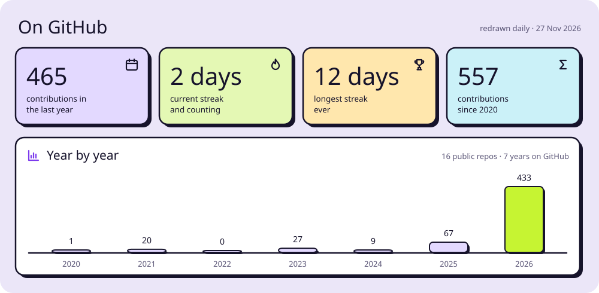</picture>

<picture><source media="(prefers-color-scheme: dark) and (max-width: 600px)" srcset="assets/heatmap-phone-dark.svg"><source media="(max-width: 600px)" srcset="assets/heatmap-phone-light.svg"><source media="(prefers-color-scheme: dark)" srcset="assets/heatmap-dark.svg">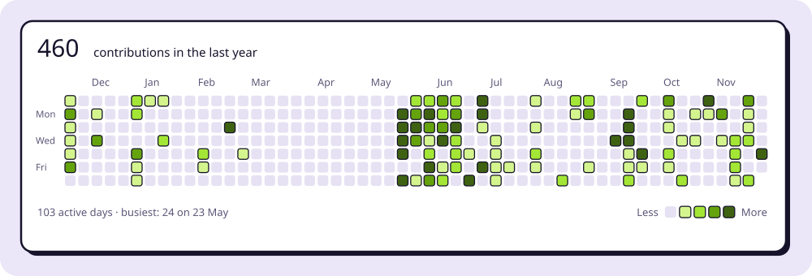</picture>

<picture><source media="(prefers-color-scheme: dark) and (max-width: 600px)" srcset="assets/weekly-phone-dark.svg"><source media="(max-width: 600px)" srcset="assets/weekly-phone-light.svg"><source media="(prefers-color-scheme: dark)" srcset="assets/weekly-dark.svg">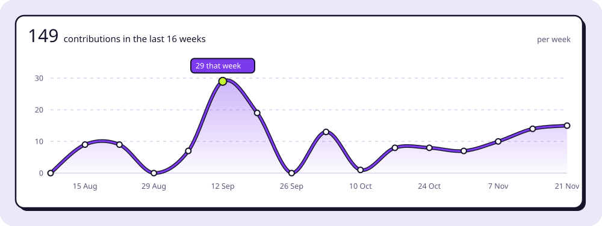</picture>

<picture><source media="(prefers-color-scheme: dark) and (max-width: 600px)" srcset="assets/whoami-phone-dark.svg"><source media="(max-width: 600px)" srcset="assets/whoami-phone-light.svg"><source media="(prefers-color-scheme: dark)" srcset="assets/whoami-dark.svg">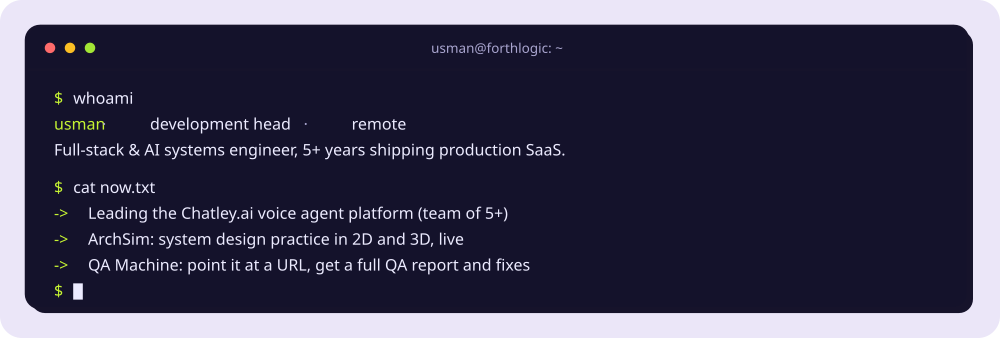</picture>

<picture><source media="(prefers-color-scheme: dark) and (max-width: 600px)" srcset="assets/label-build-phone-dark.svg"><source media="(max-width: 600px)" srcset="assets/label-build-phone-light.svg"><source media="(prefers-color-scheme: dark)" srcset="assets/label-build-dark.svg"></picture>

<a href="https://github.com/UsmanQasim/Archsim"><picture><source media="(prefers-color-scheme: dark) and (max-width: 600px)" srcset="assets/project-archsim-phone-dark.svg"><source media="(max-width: 600px)" srcset="assets/project-archsim-phone-light.svg"><source media="(prefers-color-scheme: dark)" srcset="assets/project-archsim-dark.svg">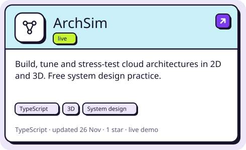</picture></a>
<a href="https://www.chatley.ai/"><picture><source media="(prefers-color-scheme: dark) and (max-width: 600px)" srcset="assets/project-chatley-phone-dark.svg"><source media="(max-width: 600px)" srcset="assets/project-chatley-phone-light.svg"><source media="(prefers-color-scheme: dark)" srcset="assets/project-chatley-dark.svg">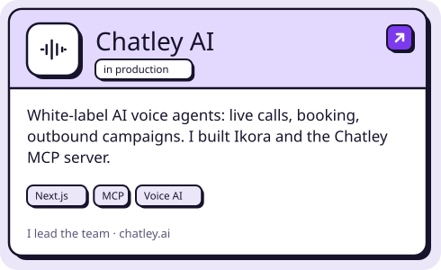</picture></a>
<picture><source media="(prefers-color-scheme: dark) and (max-width: 600px)" srcset="assets/project-qa-phone-dark.svg"><source media="(max-width: 600px)" srcset="assets/project-qa-phone-light.svg"><source media="(prefers-color-scheme: dark)" srcset="assets/project-qa-dark.svg">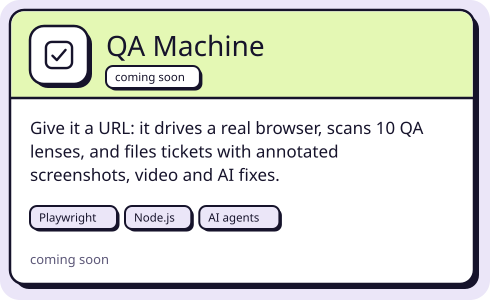</picture>
<a href="https://www.fudii.ai/"><picture><source media="(prefers-color-scheme: dark) and (max-width: 600px)" srcset="assets/project-fudii-phone-dark.svg"><source media="(max-width: 600px)" srcset="assets/project-fudii-phone-light.svg"><source media="(prefers-color-scheme: dark)" srcset="assets/project-fudii-dark.svg">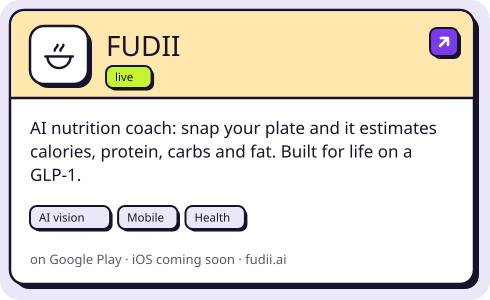</picture></a>
<a href="https://github.com/UsmanQasim/house-builder"><picture><source media="(prefers-color-scheme: dark) and (max-width: 600px)" srcset="assets/project-forthhome-phone-dark.svg"><source media="(max-width: 600px)" srcset="assets/project-forthhome-phone-light.svg"><source media="(prefers-color-scheme: dark)" srcset="assets/project-forthhome-dark.svg">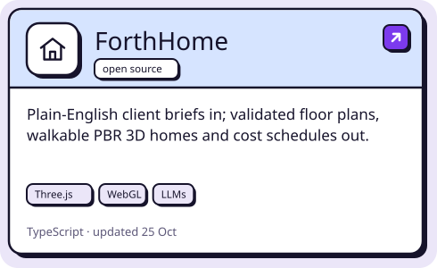</picture></a>
<a href="https://github.com/UsmanQasim/store-for-all"><picture><source media="(prefers-color-scheme: dark) and (max-width: 600px)" srcset="assets/project-dukaan-phone-dark.svg"><source media="(max-width: 600px)" srcset="assets/project-dukaan-phone-light.svg"><source media="(prefers-color-scheme: dark)" srcset="assets/project-dukaan-dark.svg">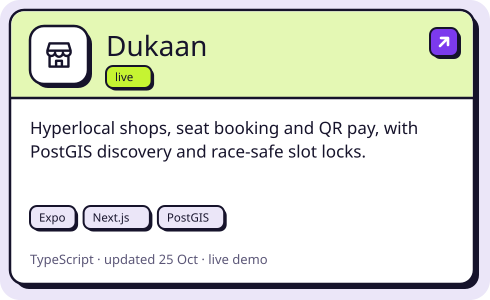</picture></a>
<a href="https://github.com/UsmanQasim/ApnaGhar"><picture><source media="(prefers-color-scheme: dark) and (max-width: 600px)" srcset="assets/project-ghar-phone-dark.svg"><source media="(max-width: 600px)" srcset="assets/project-ghar-phone-light.svg"><source media="(prefers-color-scheme: dark)" srcset="assets/project-ghar-dark.svg">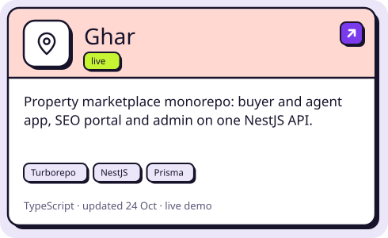</picture></a>
<a href="https://github.com/UsmanQasim/MEN-TAL"><picture><source media="(prefers-color-scheme: dark) and (max-width: 600px)" srcset="assets/project-mental-phone-dark.svg"><source media="(max-width: 600px)" srcset="assets/project-mental-phone-light.svg"><source media="(prefers-color-scheme: dark)" srcset="assets/project-mental-dark.svg">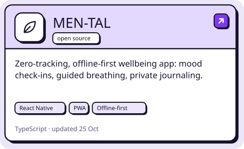</picture></a>

<picture><source media="(prefers-color-scheme: dark) and (max-width: 600px)" srcset="assets/label-stack-phone-dark.svg"><source media="(max-width: 600px)" srcset="assets/label-stack-phone-light.svg"><source media="(prefers-color-scheme: dark)" srcset="assets/label-stack-dark.svg">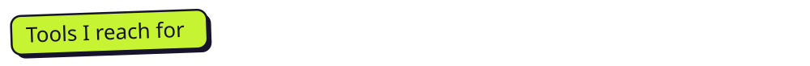</picture>

<picture><source media="(prefers-color-scheme: dark) and (max-width: 600px)" srcset="assets/stack-phone-dark.svg"><source media="(max-width: 600px)" srcset="assets/stack-phone-light.svg"><source media="(prefers-color-scheme: dark)" srcset="assets/stack-dark.svg">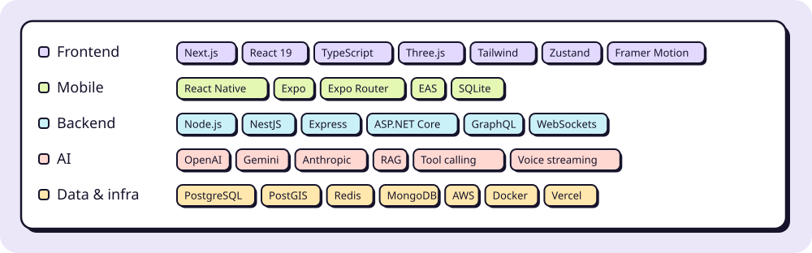</picture>

<picture><source media="(prefers-color-scheme: dark) and (max-width: 600px)" srcset="assets/label-career-phone-dark.svg"><source media="(max-width: 600px)" srcset="assets/label-career-phone-light.svg"><source media="(prefers-color-scheme: dark)" srcset="assets/label-career-dark.svg"></picture>

<picture><source media="(prefers-color-scheme: dark) and (max-width: 600px)" srcset="assets/career-phone-dark.svg"><source media="(max-width: 600px)" srcset="assets/career-phone-light.svg"><source media="(prefers-color-scheme: dark)" srcset="assets/career-dark.svg">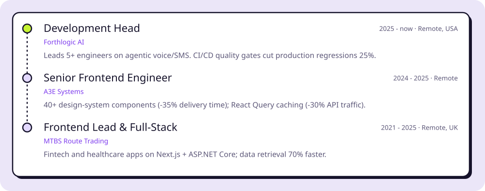</picture>

Open to senior / staff full-stack, frontend lead and AI systems roles · <a href="mailto:1998usman@gmail.com">1998usman@gmail.com</a> Cards redrawn every day by a GitHub Action from live GitHub data

